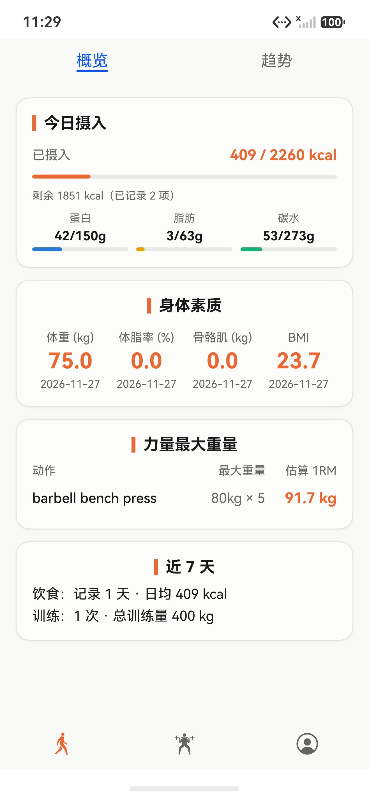
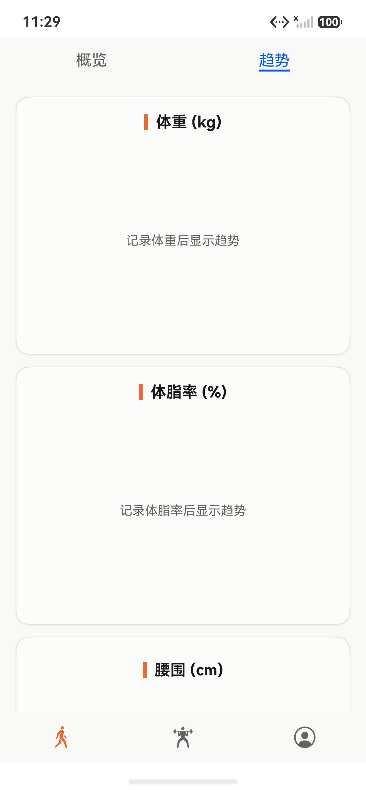
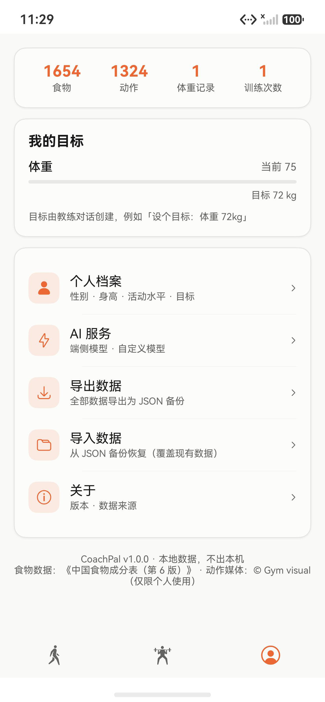

# CoachPal

鸿蒙原生健身与饮食记录 App（ArkTS/ArkUI，Stage 模型，bundleName `com.coachpal.app`）。**仓库根目录即 DevEco 工程**，无服务端依赖，数据全部本地。

- 记录身高、体重、体脂率、骨骼肌量、围度
- 记录力量训练（自动估算 1RM）和每次训练的动作/组数/重量/次数
- 记录每日饮食，按《中国食物成分表（第 6 版）》自动计算热量与宏量（内置 1677 条食物数据）
- 1324 个动作库（含动画 GIF、中文分步要领），教练对话自动展示示范动画
- AI 教练对话：华为端侧模型或自定义 OpenAI 兼容接口（App 内「AI 配置」页直连，不经过服务器）
- 趋势图与周复盘、明暗主题

## 界面预览

| 教练对话 | 身体概览 |
| --- | --- |
|  |  |
| **趋势** | **我的** |
|  |  |
| **AI 服务** | **个人档案** |
|  |  |

## 快速开始

用 DevEco Studio 打开仓库根目录，等待 Sync 完成，连接设备/模拟器后 Run。

命令行构建：

```bash
bash build.sh               # assembleHap → entry/build/default/outputs/default/*.hap
bash build.sh test          # Hypium LocalUnit 单测
hdc install entry/build/default/outputs/default/entry-default-unsigned.hap
hdc shell aa start -b com.coachpal.app -a EntryAbility
```

详细说明（工程结构、AI 配置、FAQ）见 [docs/HARMONYOS.md](docs/HARMONYOS.md)。

## 数据说明

- 食物（`foods.json`，1677 条）与动作（`exercises.json`，1324 个）内置于
  `entry/src/main/resources/rawfile/`，首启由 `Seed.ets` 幂等导入 SQLite
- 动画 GIF（约 123MB，来源 [hasaneyldrm/exercises-dataset](https://github.com/hasaneyldrm/exercises-dataset)，媒体 © Gym visual）也在
  rawfile 下，但**不入库**（`.gitignore`），换机器时从上游仓库重新拷贝到
  `entry/src/main/resources/rawfile/{videos,images}/`
- 动作演示数据仅限本机个人使用，请勿再分发

## 许可提示

食物成分数据整理自《中国食物成分表标准版（第 6 版）》（上游
[Sanotsu/china-food-composition-data](https://github.com/Sanotsu/china-food-composition-data)），
原书为出版物，数据仅限个人使用。
